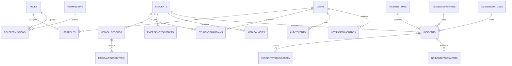

# Base central de SIRA

La base central de SIRA usa SQL Server 2022. La app Android se comunica con la API Node.js de `server/`; la API autentica usuarios y aplica permisos antes de consultar SQL Server. El esquema principal vive en `database/001_schema.sql`; Room/SQLCipher queda como almacenamiento local de expedientes cuando se usa el modo demo.

## Contenido

`001_schema.sql` crea el esquema inicial, catálogos y permisos base para los módulos descritos abajo. El backend agrega los scripts `server/sql/002_api_soporte.sql` y `server/sql/003_login_api.sql` para completar los folios y permisos de la API, y crear su cuenta de base de datos.

- usuarios, roles, permisos, sesiones y tokens de activación/restablecimiento;
- alumnos y relaciones con madres, padres o tutores;
- expedientes, alergias, padecimientos, medicamentos, contactos de emergencia e ingresos a enfermería;
- incidencias, estados, evidencias y motivo de eliminación;
- preferencias y cola de salida para notificaciones;
- bitácora append-only y registro de ejecuciones/programación de respaldos.

Las matrículas se guardan como texto para conservar letras y ceros iniciales. Las fotos y evidencias no se guardan como BLOB: se conserva una clave de almacenamiento y SHA-256 para verificar integridad.

## Levantar SQL Server para desarrollo

SQL Server Developer es únicamente para desarrollo y pruebas, no para producción. Microsoft distribuye la imagen `mcr.microsoft.com/mssql/server:2022-latest`; las imágenes de SQL Server en contenedor están soportadas en hosts Linux x86-64 Intel/AMD. Este entorno Codex corre en `arm64`, por lo que Docker Compose está preparado para los integrantes/equipos x86-64, pero no debe considerarse una instalación local soportada en Apple Silicon. Usa una instancia SQL Server x86-64 del equipo o una instancia remota aprobada.

1. Copia `.env.example` a `.env` y asigna a `MSSQL_SA_PASSWORD` una contraseña local fuerte. `.env` está ignorado por Git; no subas la contraseña.
2. En un host x86-64 con Docker, inicia el servicio con `docker compose up -d`.
3. Conéctate a `localhost,1433` con un cliente SQL y ejecuta en orden `database/001_schema.sql`, `server/sql/002_api_soporte.sql` y `server/sql/003_login_api.sql`. Compose monta los directorios en `/scripts` y `/server-sql` dentro del contenedor. Cambia el valor de ejemplo de la contraseña en `003_login_api.sql` antes de ejecutarlo y usa la misma contraseña en `server/.env`.
4. La base `SIRA` y los catálogos se crean con el primer script. El volumen Docker conserva los datos al reiniciar el contenedor. Para borrar la base local deliberadamente: `docker compose down -v` (esto elimina permanentemente los datos del volumen).

La API se configura por separado: copia `server/.env.example` a `server/.env`, ajusta las credenciales de SQL Server e inicia el servidor siguiendo `server/README.md`. `.env` en la raíz configura Docker; `server/.env` configura Node.js. Ambos están excluidos de Git.

Para desarrollo puede usarse Azure Data Studio/SSMS/sqlcmd u otro cliente compatible. Si usas sqlcmd dentro del contenedor, la ruta de las herramientas actuales es `/opt/mssql-tools18/bin/sqlcmd`; Microsoft documenta esa ruta para imágenes SQL Server 2022 CU14 y posteriores.

## Decisiones de seguridad y operación

- Guardar en `Users.PasswordHash` solo un hash adaptativo producido por el backend: Argon2id, bcrypt o PBKDF2 con sal. No usar SHA-256 simple para contraseñas. Los tokens de un solo uso se guardan como hash SHA-256 de tokens aleatorios de alta entropía; nunca se persiste el token enviado al usuario.
- El backend debe validar permisos **en cada endpoint**. La navegación Android por rol es solo UX. Para un tutor, autorizar cada consulta mediante `StudentGuardians`; nunca confiar en un `StudentId` que venga del cliente.
- Antes de cada operación del backend, establecer `SESSION_CONTEXT('ActorUserId')` con el usuario ya autenticado para que los triggers atribuyan cambios. Las conexiones agrupadas deben sobrescribir/limpiar ese contexto entre solicitudes.
- Las incidencias se borran físicamente mediante `dbo.usp_DeleteIncident`, que exige Administrador con `incidents.delete`, motivo obligatorio y transacción. Se retiene un asiento de auditoría mínimo (folio, ID, actor, hora y motivo), no el contenido completo eliminado. El procedimiento también exige que la cuenta esté activa.
- Las notificaciones se modelan como outbox; un worker/backend debe despacharlas, reintentarlas y marcar su resultado. La base por sí sola no envía push ni correo.
- `BackupSchedules` y `BackupRuns` registran configuración/resultado; un programador externo debe ejecutar `BACKUP DATABASE` diariamente a las 02:00 UTC o según la zona horaria que acuerde el equipo.
- `001_schema.sql` es la migración inicial para una base vacía. Cambios futuros deben agregarse como `002_...sql`, sin editar migraciones ya aplicadas.

## Modelo relacional resumido

## Decisiones del IEEE que el equipo debe ratificar

El diseño conserva permisos configurables para representar las historias específicas: HU-7/RF-12 permite al tutor reportar; HU-5/RF-11 le permite editar su reporte; HU-18/RF-17 deja borrar al Administrador. Esto difiere de la sección 2.1, que atribuye algunas acciones al Director. Los grants iniciales siguen los HU/RF específicos, pero deben confirmarse antes de desplegar.

El IEEE también mezcla una aplicación móvil con requerimientos de web, Android/iOS y Docker. Este esquema cubre la base central SQL Server; no crea el backend ni adapta la app a iOS/web.
